<!-- ============================================================
  ANTES DE SUBIR, TROQUE:
  SEU-USUARIO  -> seu usuário do GitHub / LinkedIn
  seuemail@exemplo.com -> seu e-mail
  O banner está dividido em partes (pasta assets/) para que os botões
  LinkedIn e E-mail sejam clicáveis. Mantenha cada linha de imagens
  inteira numa única linha, sem espaços entre as tags.
============================================================ -->

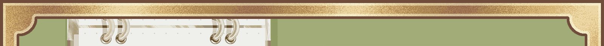

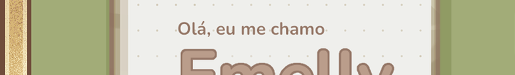<a href="https://www.linkedin.com/in/SEU-USUARIO/">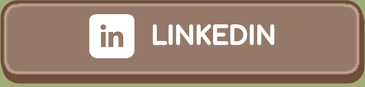</a>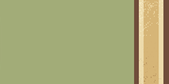

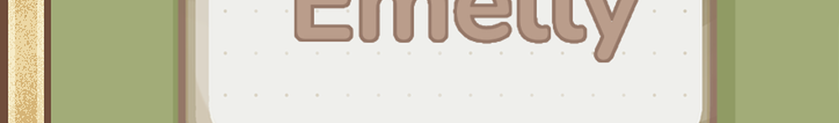<a href="mailto:seuemail@exemplo.com">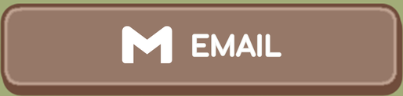</a>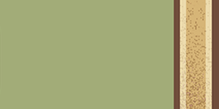

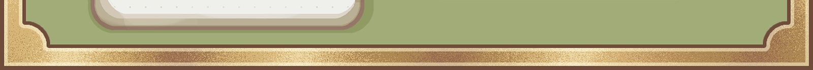

 

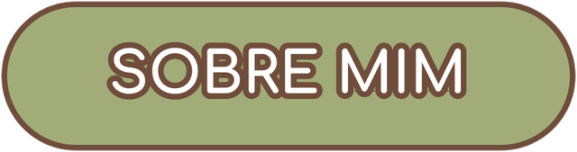

- Cursando Bacharelado em Sistemas de Informação pelo IFES.
- Formada como Técnica em Administração, unindo a visão de negócios com a tecnologia.
- Apaixonada por Design e Ilustração Digital.
- Objetivo: Busco meu primeiro estágio em TI

 

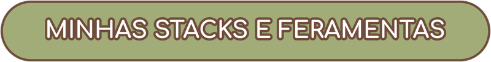

 

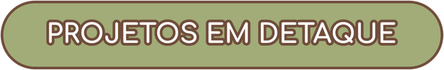

<table>
  <tr>
    <td width="50%" valign="top">
      
        
      Descrição do projeto 1: o que ele faz e quais tecnologias usa.
    </td>
    <td width="50%" valign="top">
      
        
      Descrição do projeto 2: o que ele faz e quais tecnologias usa.
    </td>
  </tr>
</table>

 

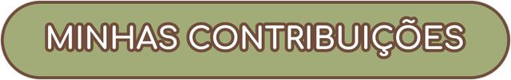

