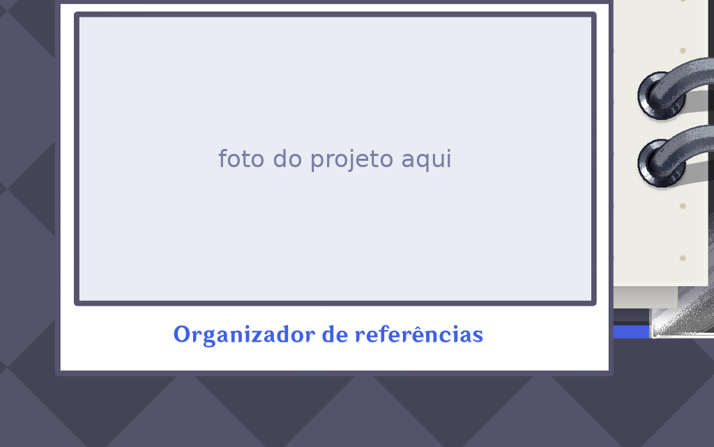
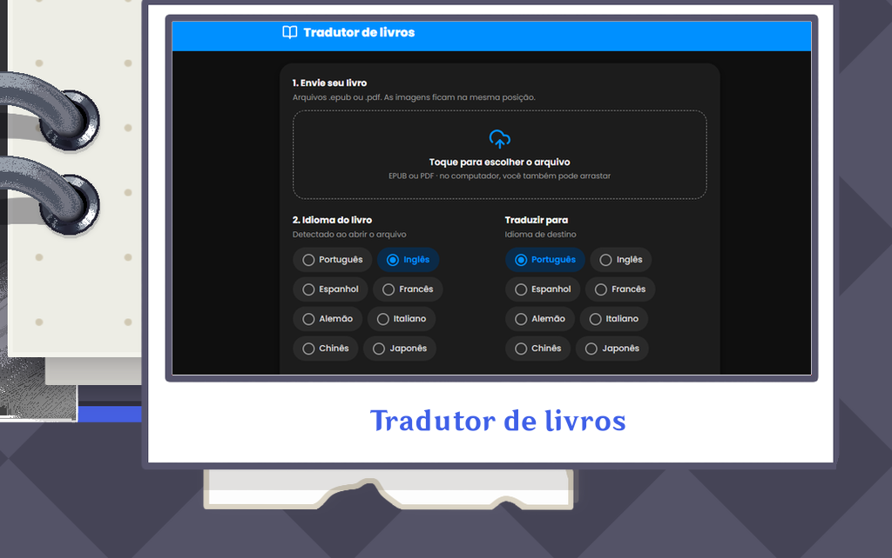

   

  <picture>
    <source media="(prefers-color-scheme: dark)" srcset="https://raw.githubusercontent.com/Emellymarvila/Emellymarvila/output/github-snake-dark.svg?palette=github-dark&color_snake=#39FF14&color_dots=#161b22,#0e4429,#006d32,#26a641,#39d353" />
    <source media="(prefers-color-scheme: light)" srcset="https://raw.githubusercontent.com/Emellymarvila/Emellymarvila/output/github-snake.svg" />
    
  </picture>

